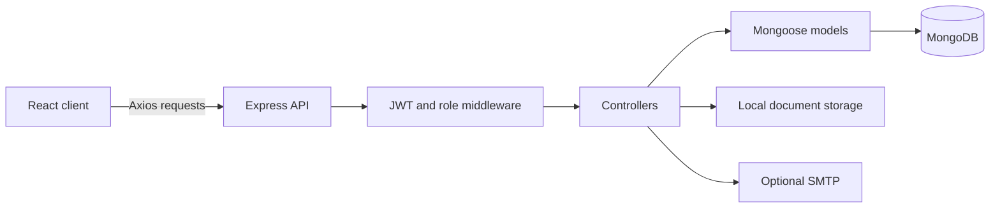

# Architecture and API

During development, Vite proxies `/api` and `/uploads` to the backend. The backend does not serve the built SPA; production needs separate frontend hosting/routing configuration.

## Data model

- `User`: profile, hashed password, role, active flag.
- `Country`: destination information, visa types, fees, required documents.
- `VisaApplication`: applicant/country references, traveler details, documents, status history, assignment, fee, payment status.
- `ContactMessage`: enquiries and their handling state.
- `Testimonial`, `Office`: public content. Offices are seeded; there is no standalone office route mounted in `server.js`.

Statuses: `submitted`, `under_review`, `additional_docs_required`, `approved`, `rejected`, `cancelled`. Admin updates accept any listed status; transition rules are not enforced.

## Routes

Paths are relative to `/api`. Private requests use `Authorization: Bearer <token>`. See route validators and models for request fields.

| Method | Path | Access/purpose |
| --- | --- | --- |
| GET | `/health` | Public; API response only, not database health |
| POST | `/auth/register`, `/auth/login` | Public accounts |
| GET, PUT | `/auth/me` | Current user/profile |
| GET | `/countries`, `/countries/:slug` | Public destinations |
| POST | `/countries` | Admin create |
| PUT, DELETE | `/countries/:id` | Admin update/delete |
| POST | `/visa-applications` | Authenticated submission |
| GET | `/visa-applications/mine` | Current user's applications |
| GET | `/visa-applications/:id` | Owner/admin detail |
| POST | `/visa-applications/:id/documents` | Owner upload; multipart field `documents`, up to six files/request |
| PUT | `/visa-applications/:id/cancel` | Owner cancellation for eligible statuses |
| GET | `/visa-applications` | Admin queue; status, country, search, page, limit |
| GET | `/visa-applications/stats/summary` | Admin counts/recent applications |
| PUT | `/visa-applications/:id/status` | Admin; status and optional note |
| PUT | `/visa-applications/:id/assign` | Admin; userId |
| POST | `/contact` | Public enquiry |
| GET | `/contact` | Admin enquiries |
| PUT | `/contact/:id` | Admin enquiry update |
| GET | `/testimonials` | Public content |
| POST | `/testimonials` | Admin create |
| PUT, DELETE | `/testimonials/:id` | Admin update/delete |
| GET | `/admin/users` | Admin user list |
| PUT | `/admin/users/:id` | Admin role/active-state update |

Responses generally include `success` and `data`; errors include `success: false` and `message`. Static `/uploads` currently bypasses API access checks; see the quality notes.
